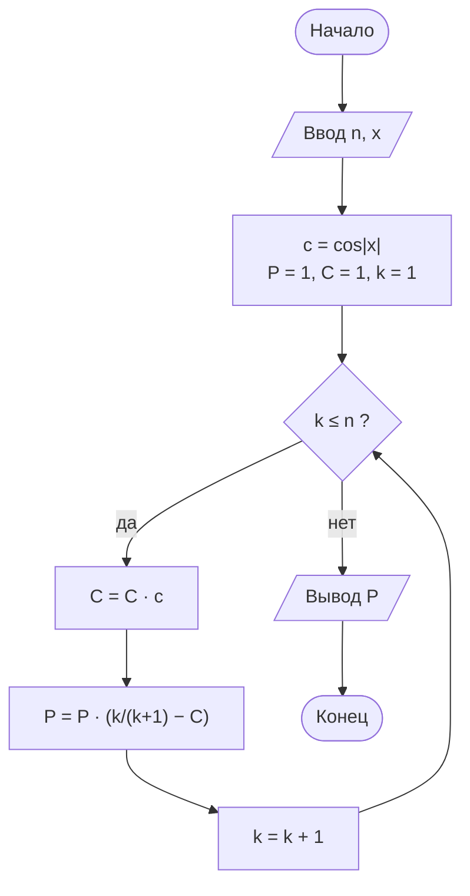
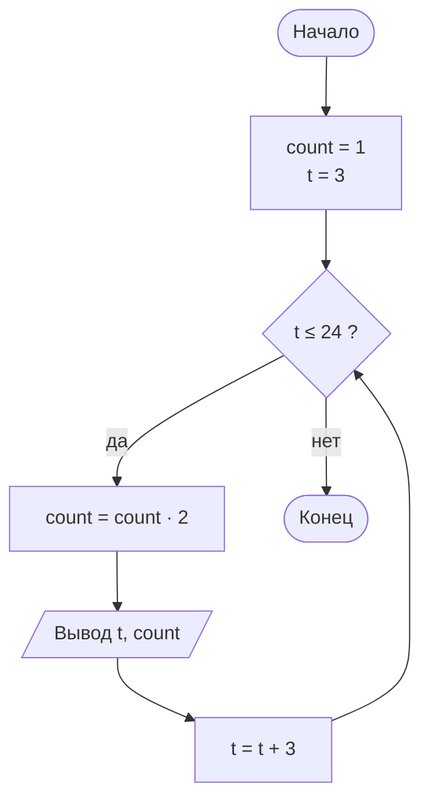

# Лабораторная работа 4.1 — Алгоритмы циклической структуры

**Вариант:** 5
**Язык:** Java 17 (по согласованию с преподавателем вместо Python)

**Цель работы:** научиться разрабатывать алгоритмы циклической структуры, записывать их словесно и
графически, изучить операторы цикла `for`, `while`, `do-while`.

Код: [`TaskA.java`](../src/main/java/ru/college/practice/lab4/TaskA.java),
[`TaskB.java`](../src/main/java/ru/college/practice/lab4/TaskB.java),
тесты: [`Lab4Test.java`](../src/test/java/ru/college/practice/lab4/Lab4Test.java).

---

## Задание А

Составить блок-схему и программу вычисления произведения:

$$P = \prod_{k=1}^{n}\left(\frac{k}{k+1} - \cos^k|x|\right)$$

### Словесная запись алгоритма

1. Начало.
2. Ввести n (натуральное) и x.
3. Вычислить c = cos|x|.
4. Присвоить P = 1 (начальное значение произведения), C = 1 (будущая степень cosᵏ|x|), k = 1.
5. Пока k ≤ n, выполнять:
   - C = C · c (получаем cosᵏ|x|);
   - P = P · (k / (k + 1) − C);
   - k = k + 1.
6. Конец цикла.
7. Вывести P.
8. Конец.

Произведение начинают с 1, а не с 0, как сумму: иначе результат всегда будет равен нулю.
Степень cosᵏ|x| не считают заново на каждом шаге, а домножают на cos|x|.

### Блок-схема



### Программа (фрагмент, цикл с предусловием)

```java
double cosAbsX = Math.cos(Math.abs(x));
double cosPow = 1;
double p = 1;
int k = 1;
while (k <= n) {
    cosPow *= cosAbsX;
    p *= (double) k / (k + 1) - cosPow;
    k++;
}
```

В `TaskA` это же произведение вычислено ещё через `for` и `do-while`, результаты совпадают.

### Результат выполнения

```
Введите n (натуральное число): n = 4
Введите x: x = 1

P (for)      = -0,006394
P (while)    = -0,006394
P (do-while) = -0,006394
```

Проверка вручную (cos 1 ≈ 0,5403):
(0,5 − 0,5403)(0,6667 − 0,2919)(0,75 − 0,1577)(0,8 − 0,0852) ≈ −0,0403 · 0,3748 · 0,5923 · 0,7148 ≈ −0,0064 ✔

---

## Задание Б

Одноклеточная амёба каждые три часа делится на 2 клетки. Определить, сколько амёб будет через
3, 6, 9, 12, …, 24 часа (ответ: 256).

### Словесная запись алгоритма

1. Начало.
2. Присвоить count = 1 (в начале одна амёба).
3. Для t от 3 до 24 с шагом 3 выполнять:
   - count = count · 2;
   - вывести t и count.
4. Конец цикла.
5. Конец.

### Блок-схема



### Результат выполнения

```
Часы | Амёб
-----+-----
   3 | 2
   6 | 4
   9 | 8
  12 | 16
  15 | 32
  18 | 64
  21 | 128
  24 | 256

Через 24 часа будет 256 амёб
```

Ответ совпадает с ответом в методичке: 2⁸ = 256.

---

## Ответы на контрольные вопросы

1. **Как записывается и как работает оператор FOR?**
   `for (инициализация; условие; изменение) { тело }`. Один раз выполняется инициализация, затем перед
   каждым витком проверяется условие. Если оно истинно, выполняется тело, затем изменение счётчика,
   и снова проверка условия. Если условие ложно, цикл завершается.

2. **Для организации каких циклов применим оператор FOR?**
   В первую очередь для циклов с известным заранее числом повторений (со счётчиком), например для
   прохода по k = 1…n или по элементам массива. В Java есть ещё `for-each`:
   `for (int v : array)`.

3. **В чём отличие оператора WHILE от оператора DO WHILE?**
   `while` проверяет условие до выполнения тела, и тело может не выполниться ни разу.
   `do-while` проверяет условие после тела, и тело выполняется хотя бы один раз.
   В Java `do-while` повторяется, пока условие **истинно**.

4. **Как программируются циклы с явно заданным числом повторений?**
   С помощью счётчика: `for (int k = 1; k <= n; k++)` (задание А, задание Б).

5. **Как программируются циклы с заранее неизвестным числом повторений?**
   С помощью `while` или `do-while` с условием выхода, зависящим от данных. Например, ввод n
   повторяется, пока пользователь не введёт натуральное число:
   `do { n = in.nextInt(); } while (n < 1);`

6. **Напишите оператор цикла, который не выполняется ни разу.**
   `for (int i = 0; i < 0; i++) { ... }` или `int k = 5; while (k < 0) { ... }`.
   Условие сразу ложно, поэтому тело не выполняется ни разу.

7. **В каких случаях используются операторные скобки?**
   Фигурные скобки `{ }` нужны, когда в теле цикла (или ветке `if`) больше одного оператора.
   Для одного оператора их можно не писать, но обычно ставят всегда: так меньше ошибок при
   добавлении строк.

8. **Как работают операторы управления циклом?**
   `break` немедленно завершает ближайший цикл, и выполнение продолжается после него.
   `continue` прерывает текущий виток и переходит к следующей проверке условия (в `for` — сначала
   к изменению счётчика). В Java также есть `break`/`continue` с меткой для выхода из вложенных циклов.

---

## Запуск

Из IntelliJ: запустить `main` в `TaskA` или `TaskB`.

Тесты из консоли:

```bash
./mvnw test -Dtest=Lab4Test
```
