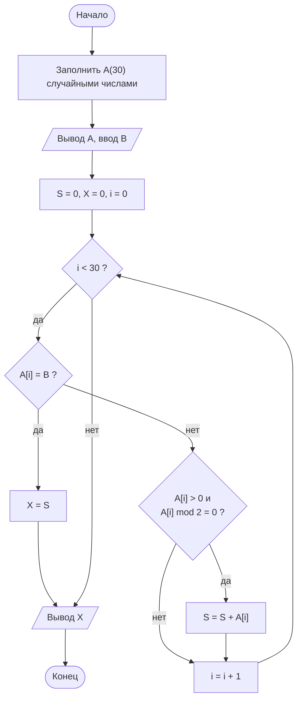
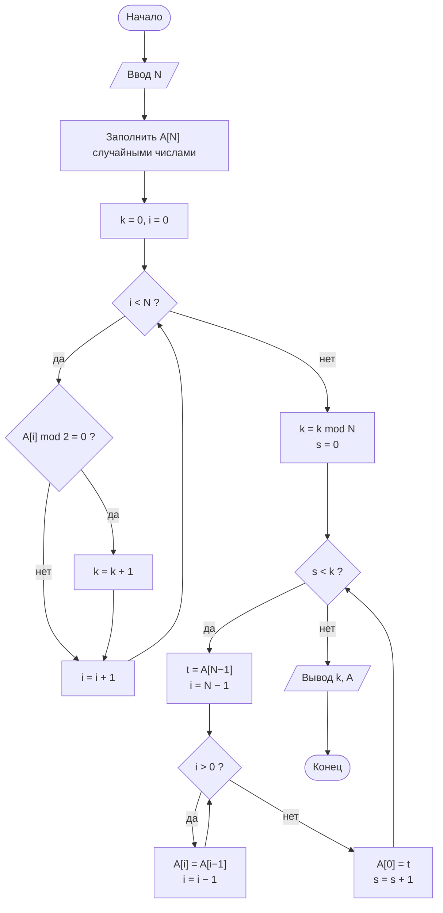

# Лабораторная работа 5.1 — Алгоритмы обработки одномерных массивов

**Вариант:** 5
**Язык:** Java 17 (по согласованию с преподавателем вместо Python)

**Цель работы:** научиться обрабатывать одномерные массивы: поиск элементов, накопление сумм по условию,
сдвиг элементов, заполнение массива случайными числами.

Код: [`TaskA.java`](../src/main/java/ru/college/practice/lab5/TaskA.java),
[`TaskB.java`](../src/main/java/ru/college/practice/lab5/TaskB.java),
тесты: [`Lab5Test.java`](../src/test/java/ru/college/practice/lab5/Lab5Test.java).

---

## Задание А

Если у массива A(30) есть элемент, равный B, то переменной X присвоить значение, равное сумме всех
положительных чётных элементов, предшествующих первому по порядку такому элементу, иначе переменной
X присвоить 0.

### Словесная запись алгоритма

1. Начало.
2. Заполнить массив A(30) случайными числами от −10 до 10 и вывести его.
3. Ввести B.
4. Присвоить S = 0, i = 0, X = 0.
5. Пока i < 30, выполнять:
   - если A[i] = B, то X = S и перейти к п. 6 (выход из цикла);
   - если A[i] > 0 и A[i] чётное, то S = S + A[i];
   - i = i + 1.
6. Вывести X.
7. Конец.

Если цикл дошёл до конца массива и элемент, равный B, не встретился, X остаётся равным 0.
Сумму S копим заранее, а присваиваем в X только при найденном B: так массив проходится один раз.

### Блок-схема



### Программа (основной фрагмент)

```java
public static int sumPositiveEvenBeforeFirst(int[] a, int b) {
    int sum = 0;
    for (int value : a) {
        if (value == b) {
            return sum;           // нашли первый элемент, равный B
        }
        if (value > 0 && value % 2 == 0) {
            sum += value;
        }
    }
    return 0;                     // элемента, равного B, в массиве нет
}
```

### Результат выполнения

```
Массив A(30):
[2, -9, -1, 2, 1, 9, 4, 8, -2, 9, 3, -9, 8, -8, 0, 7, -6, 2, -1, 9, -1, -8, -7, 6, 3, 2, 4, -6, -8, 7]
Введите B: B = 3
Первый элемент, равный 3, стоит на позиции 11 (нумерация с 1)
X = 16
```

Проверка: до первой тройки положительные чётные элементы 2, 2, 4, 8 → 2 + 2 + 4 + 8 = 16 ✔

Если B в массиве нет:

```
Введите B: B = 4
Элемента, равного 4, в массиве нет
X = 0
```

---

## Задание Б

Дан целочисленный массив размера N. Осуществить сдвиг вправо на k позиций, где k — число чётных
элементов. Элементы массива генерировать с помощью генератора случайных чисел.

В условии не сказано, циклический ли сдвиг (у вариантов 13–25 это указано явно), поэтому реализованы
оба способа:
- **обычный сдвиг** — элементы, вышедшие за правый край, теряются, освободившиеся слева места
  заполняются нулями;
- **циклический сдвиг** — элементы, вышедшие за правый край, переходят в начало массива.

### Словесная запись алгоритма

1. Начало.
2. Ввести N (N ≥ 1).
3. Заполнить массив A[N] случайными числами от 0 до 99 и вывести его.
4. Подсчитать k: k = 0; для i от 0 до N − 1: если A[i] чётное, то k = k + 1.
5. **Обычный сдвиг:** для i от N − 1 до 0 с шагом −1: если i − k ≥ 0, то A[i] = A[i − k], иначе A[i] = 0.
   Идём с конца массива, чтобы не затереть элементы, которые ещё нужно переписать.
6. **Циклический сдвиг:** k = k mod N; k раз повторить сдвиг на одну позицию:
   - запомнить последний элемент: t = A[N − 1];
   - для i от N − 1 до 1: A[i] = A[i − 1];
   - A[0] = t.
7. Вывести k и массивы после сдвигов.
8. Конец.

### Блок-схема



*(На схеме показан циклический сдвиг. Обычный сдвиг отличается только телом цикла: один проход
с конца массива, A[i] = A[i − k] или 0.)*

### Программа (основной фрагмент)

```java
public static int countEven(int[] a) {
    int count = 0;
    for (int value : a) {
        if (value % 2 == 0) {
            count++;
        }
    }
    return count;
}

public static void shiftRight(int[] a, int k) {
    int n = a.length;
    for (int i = n - 1; i >= 0; i--) {
        a[i] = (i - k >= 0) ? a[i - k] : 0;
    }
}

public static void cyclicShiftRight(int[] a, int k) {
    int n = a.length;
    k %= n;
    for (int step = 0; step < k; step++) {
        int last = a[n - 1];
        for (int i = n - 1; i > 0; i--) {
            a[i] = a[i - 1];
        }
        a[0] = last;
    }
}
```

### Результат выполнения

```
Введите размер массива N: N = 10
Сгенерированный массив:
[10, 46, 14, 31, 35, 31, 11, 93, 38, 52]
Число чётных элементов k = 5
Сдвиг вправо на k (с заполнением нулями):
[0, 0, 0, 0, 0, 10, 46, 14, 31, 35]
Циклический сдвиг вправо на k:
[31, 11, 93, 38, 52, 10, 46, 14, 31, 35]
```

Проверка: чётные — 10, 46, 14, 38, 52 → k = 5. При циклическом сдвиге последние 5 элементов
(31, 11, 93, 38, 52) переходят в начало ✔

---

## Ответы на контрольные вопросы

В Java нет указателей и адресной арифметики, поэтому вопросы 3 и 5–8 объясняются через ссылки
и сравнение с C.

1. **Каким образом определяются переменные типа массив?**
   `int[] a = new int[30];` — массив из 30 элементов, заполненный нулями.
   `int[] d = {23, 45, 32, 12, 88};` — с начальными значениями.
   Массив в Java — объект, его длина хранится в поле `a.length` и после создания не меняется.

2. **Какие операторы используются при обработке элементов массива?**
   Циклы `for` (по индексу) и `for-each` (`for (int v : a)`), `while`, условный оператор `if`,
   присваивание элементов `a[i] = ...`, операции `break`/`return` для досрочного выхода.
   Для вывода удобно `Arrays.toString(a)`.

3. **Как осуществляется доступ к отдельному элементу массива с помощью указателя?**
   В C: `*(uk + i)` или `uk[i]`, где `uk` указывает на начало массива.
   В Java доступ только по индексу `a[i]`. Переменная `a` хранит ссылку на объект-массив,
   а выход за границы вызывает исключение `ArrayIndexOutOfBoundsException`.

4. **Каким образом выводятся элементы массива на экран?**
   Циклом: `for (int v : a) System.out.print(v + " ");`, либо одной строкой
   `System.out.println(Arrays.toString(a));`.

5. **Какой результат унарной операции `&`?**
   В C — адрес переменной в памяти. В Java такой операции нет: адреса недоступны программисту.
   (`&` в Java — побитовое И или логическое И без сокращённого вычисления.)

6. **Какой результат унарной операции `*`?**
   В C — разыменование: значение, лежащее по адресу. В Java её нет: обращение к объекту по ссылке
   происходит автоматически (`a[i]`, `obj.field`).

7. **Выражение `uk = &a[0]` эквивалентно `uk = a`?**
   В C — да: имя массива приводится к указателю на его первый элемент.
   В Java аналог — `int[] uk = a;`: обе переменные ссылаются на один и тот же массив, поэтому
   изменения через `uk` видны и через `a`.

8. **Выражения `&a[i]` и `a + i` идентичны?**
   В C — да, оба дают адрес i-го элемента (адресная арифметика учитывает размер элемента).
   В Java адресной арифметики нет, элемент доступен только как `a[i]`.

---

## Запуск

Из IntelliJ: запустить `main` в `TaskA` или `TaskB`.

Тесты из консоли:

```bash
./mvnw test -Dtest=Lab5Test
```
