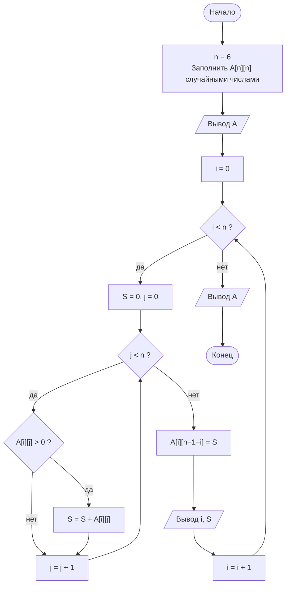
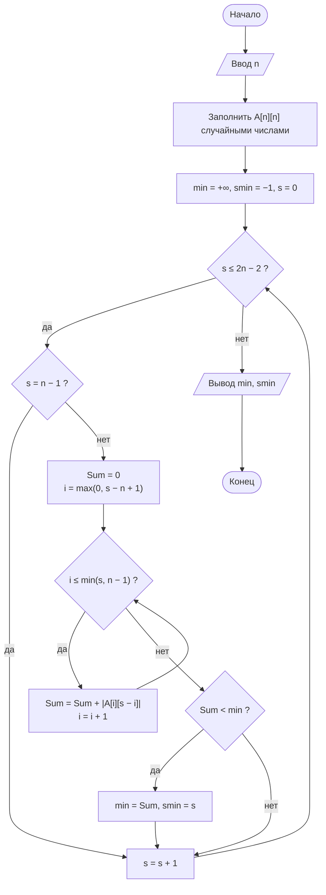

# Лабораторная работа 6 — Алгоритмы обработки двумерных массивов

**Вариант:** 5
**Язык:** Java 17 (по согласованию с преподавателем вместо Python)

**Цель работы:** научиться обрабатывать двумерные массивы (матрицы): обход по строкам и диагоналям,
накопление сумм по условию, замена элементов, заполнение случайными числами.

Код: [`TaskA.java`](../src/main/java/ru/college/practice/lab6/TaskA.java),
[`TaskB.java`](../src/main/java/ru/college/practice/lab6/TaskB.java),
[`MatrixUtils.java`](../src/main/java/ru/college/practice/lab6/MatrixUtils.java) (заполнение и вывод),
тесты: [`Lab6Test.java`](../src/test/java/ru/college/practice/lab6/Lab6Test.java).

Нумерация индексов в программе — с нуля: строки и столбцы 0…n−1.

---

## Задание А

Дан массив A[6,6]. Найти суммы положительных элементов строк и присвоить их элементам побочной
диагонали соответствующих строк.

Побочная диагональ идёт из правого верхнего угла в левый нижний: в строке i это элемент A[i][n−1−i].

### Словесная запись алгоритма

1. Начало.
2. Присвоить n = 6. Заполнить матрицу A[n][n] случайными числами от −9 до 9 и вывести её.
3. Внешний цикл по строкам: для i от 0 до n − 1:
   - S = 0;
   - внутренний цикл по столбцам: для j от 0 до n − 1: если A[i][j] > 0, то S = S + A[i][j];
   - A[i][n − 1 − i] = S;
   - вывести номер строки и S.
4. Вывести изменённую матрицу.
5. Конец.

Сумма строки считается полностью до того, как в эту строку записывается элемент диагонали.
Каждая строка меняет только свой элемент, поэтому на суммы других строк замена не влияет.

### Блок-схема



### Программа (основной фрагмент)

```java
public static int[] writeRowSumsToAntiDiagonal(int[][] a) {
    int n = a.length;
    int[] sums = new int[n];
    for (int i = 0; i < n; i++) {
        sums[i] = sumPositive(a[i]);   // сумма положительных элементов строки i
        a[i][n - 1 - i] = sums[i];     // элемент побочной диагонали этой строки
    }
    return sums;
}
```

### Результат выполнения

```
Исходная матрица A[6,6]:
   -1    6   -5   -5   -9    0
    7    4   -1   -8    3   -2
    0   -1   -4    2    1    6
   -6    4   -7    8    8    6
    3   -6    8    4   -4   -3
    4    6    2   -9   -7    5

Суммы положительных элементов строк:
строка 1: 6
строка 2: 14
строка 3: 9
строка 4: 26
строка 5: 15
строка 6: 17

Матрица после записи сумм на побочную диагональ:
   -1    6   -5   -5   -9    6
    7    4   -1   -8   14   -2
    0   -1   -4    9    1    6
   -6    4   26    8    8    6
    3   15    8    4   -4   -3
   17    6    2   -9   -7    5
```

Проверка: строка 2 — 7 + 4 + 3 = 14, строка 4 — 4 + 8 + 8 + 6 = 26 ✔

---

## Задание Б

Дана целочисленная квадратная матрица. Определить минимум среди сумм модулей элементов диагоналей,
параллельных побочной диагонали матрицы.

**Идея:** у всех элементов одной диагонали, параллельной побочной, сумма индексов одинакова: i + j = s.
Для матрицы n×n s меняется от 0 (левый верхний угол) до 2n − 2 (правый нижний угол).
При s = n − 1 получается сама побочная диагональ, её не учитываем.

**Принятые допущения** (в условии не оговорены):
- сама побочная диагональ не входит в число «параллельных ей»;
- угловые диагонали из одного элемента (s = 0 и s = 2n − 2) учитываются.

Для диагонали s индекс строки i меняется от max(0, s − (n − 1)) до min(s, n − 1), а столбец j = s − i.

### Словесная запись алгоритма

1. Начало.
2. Ввести n (n ≥ 2). Заполнить матрицу A[n][n] случайными числами от −9 до 9 и вывести её.
3. Присвоить min = +∞, smin = −1.
4. Для s от 0 до 2n − 2:
   - если s = n − 1 (побочная диагональ), перейти к следующему s;
   - Sum = 0;
   - для i от max(0, s − n + 1) до min(s, n − 1): Sum = Sum + |A[i][s − i]|;
   - вывести s и Sum;
   - если Sum < min, то min = Sum, smin = s.
5. Вывести min и smin.
6. Конец.

### Блок-схема



### Программа (основной фрагмент)

```java
public static int absSumOfDiagonal(int[][] a, int s) {
    int n = a.length;
    int sum = 0;
    for (int i = Math.max(0, s - (n - 1)); i <= Math.min(s, n - 1); i++) {
        sum += Math.abs(a[i][s - i]);
    }
    return sum;
}

public static int minDiagonalIndex(int[][] a) {
    int n = a.length;
    int best = -1;
    int bestSum = Integer.MAX_VALUE;
    for (int s = 0; s <= 2 * n - 2; s++) {
        if (s == n - 1) {
            continue;          // сама побочная диагональ
        }
        int sum = absSumOfDiagonal(a, s);
        if (sum < bestSum) {
            bestSum = sum;
            best = s;
        }
    }
    return best;
}
```

### Результат выполнения

```
Введите порядок матрицы n (n >= 2): n = 5
Сгенерированная матрица:
   -5   -3   -3    8    1
   -6   -8   -9    3    8
   -8    1   -1    9   -3
    9   -3    8   -5    5
    4   -4    5    6    9

Суммы модулей диагоналей, параллельных побочной (i + j = s):
s =  0: 5
s =  1: 9
s =  2: 19
s =  3: 27
s =  4: побочная диагональ — не учитывается
s =  5: 29
s =  6: 13
s =  7: 11
s =  8: 9

Минимум = 5 (диагональ i + j = 0)
```

Проверка: s = 1 — |−3| + |−6| = 9, s = 7 — |5| + |6| = 11, s = 0 — |−5| = 5 ✔

---

## Ответы на контрольные вопросы

1. **Каким образом определяются переменные типа массив?**
   Двумерный массив в Java — это массив массивов: `int[][] a = new int[6][6];` (6 строк по 6 элементов,
   заполнено нулями) или с начальными значениями `int[][] a = {{3, 6, 7}, {11, 2, 4}};`.
   Первый индекс — номер строки, второй — номер столбца. Число строк — `a.length`,
   длина строки i — `a[i].length` (строки могут быть разной длины).

2. **Какие операторы используются при обработке элементов массива?**
   Вложенные циклы `for`: внешний по строкам, внутренний по столбцам; `for-each` по строкам
   (`for (int[] row : a)`); условный оператор `if`; `break`/`continue` для управления обходом;
   `Math.abs` и подобные функции для вычислений.

3. **Как осуществляется доступ к отдельному элементу матрицы с помощью указателя?**
   В C: `*(*(a + i) + j)` — то же, что `a[i][j]`. В Java указателей нет: доступ только по индексам
   `a[i][j]`. Сначала `a[i]` даёт ссылку на массив-строку, затем `[j]` — элемент в ней.
   Выход за границы вызывает `ArrayIndexOutOfBoundsException`.

4. **Каким образом выводятся элементы матрицы на экран?**
   Вложенными циклами: внутри строки элементы печатаются через `printf("%5d", a[i][j])`
   (ширина поля выравнивает столбцы), после каждой строки — перевод строки. Быстрый вариант —
   `System.out.println(Arrays.deepToString(a));`.

5. **Выражения `&a[i][j]` и `a+i+j` идентичны?**
   Нет, даже в C. `&a[i][j]` — адрес элемента в строке i, столбце j. `a + i` — указатель на i-ю
   **строку**, и прибавление j сдвигает ещё на j **строк**, а не элементов. Правильный аналог —
   `*(a + i) + j` (или `&a[0][0] + i*m + j` для матрицы с m столбцами).
   В Java адресной арифметики нет, элемент доступен только как `a[i][j]`.

---

## Запуск

Из IntelliJ: запустить `main` в `TaskA` или `TaskB`.

Тесты из консоли:

```bash
./mvnw test -Dtest=Lab6Test
```
