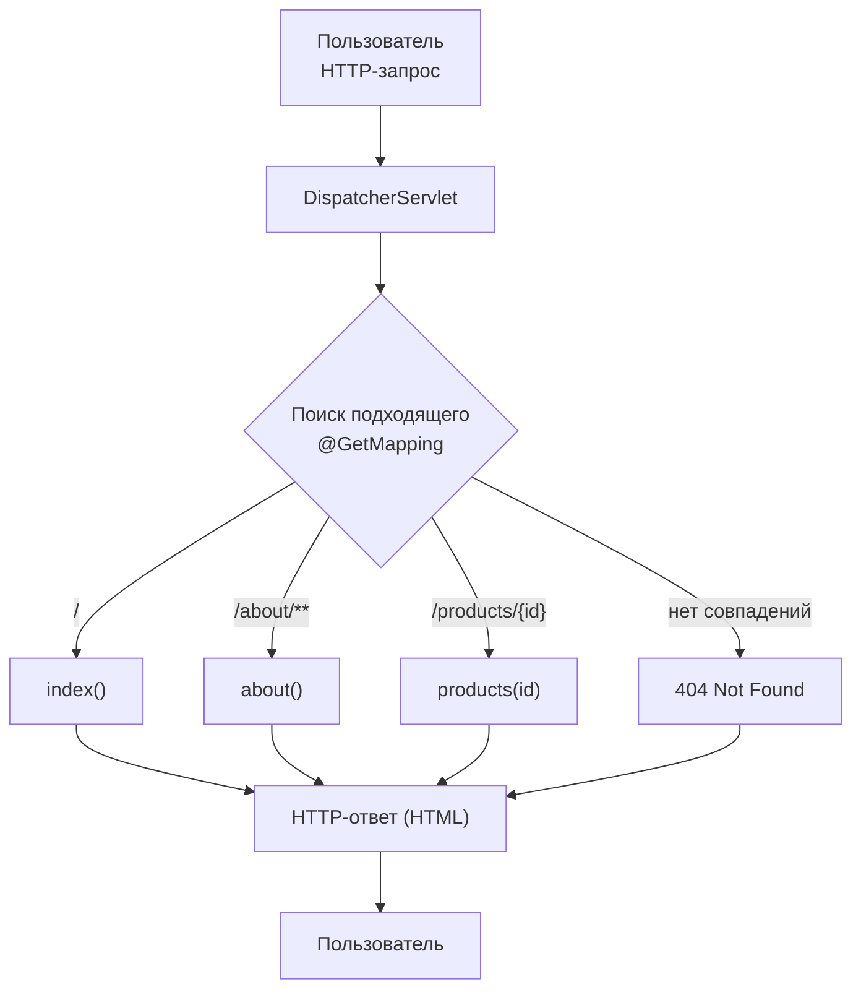

# Практика 3 — Представления и маршрутизация

**Основа:** А. Постолит «Python, Django и PyCharm», глава 4.
**Реализация:** Java 17, Spring Boot (Spring Web MVC) — по согласованию с преподавателем вместо Django.

Код: пакет [`ru.college.practice.firstapp`](../src/main/java/ru/college/practice/firstapp)
(название как у приложения `firstapp` из книги), тесты —
[`FirstAppRoutingTest.java`](../src/test/java/ru/college/practice/firstapp/FirstAppRoutingTest.java).

## Соответствие Django → Spring

| Django (книга) | Spring Boot |
|---|---|
| функция-представление в `views.py` | метод класса-контроллера с `@RestController` |
| `HttpResponse("<h2>...</h2>")` | метод возвращает `String`, тип ответа `text/html` |
| маршруты в `urls.py`: `path('about', views.about)` | аннотация над методом: `@GetMapping("/about")` |
| `re_path(r'^about', ...)` — регулярное выражение | шаблон пути `"/about/**"` |
| параметр `(?P<productid>\d+)` | `{productid:\d+}` + `@PathVariable` |
| значение по умолчанию `productid=1` | `@PathVariable(required = false)` + подстановка 1 |
| `request.GET.get("name", "Undefined")` | `@RequestParam(defaultValue = "Undefined")` |
| `HttpResponseRedirect("/about")` (302) | `ResponseEntity.status(FOUND).location(...)` |
| `HttpResponsePermanentRedirect("/")` (301) | `ResponseEntity.status(MOVED_PERMANENTLY).location(...)` |
| `HttpResponseForbidden`, `HttpResponseBadRequest` | `ResponseEntity.status(FORBIDDEN / BAD_REQUEST)` |
| `python manage.py runserver` | `mvnw spring-boot:run` или `main` в IntelliJ |

Главное отличие: в Django маршрут и функция описываются в двух разных файлах, а в Spring — в одном
месте, аннотацией над методом.

---

## 4.1. Обработка запросов пользователей (листинги 4.1–4.2)

Три страницы: **Главная**, **О сайте**, **Контакты**.

```java
@RestController
@RequestMapping(produces = MediaType.TEXT_HTML_VALUE + ";charset=UTF-8")
public class FirstAppController {

    @GetMapping("/")
    public String index() {
        return "<h2>Главная</h2>";
    }

    @GetMapping("/about/**")
    public String about() {
        return "<h2>О сайте</h2>";
    }

    @GetMapping("/contact/**")
    public String contact() {
        return "<h2>Контакты</h2>";
    }
}
```

`produces = text/html` нужен, чтобы браузер отрисовал тег `<h2>`, а не показал его как текст.

| Запрос | Ответ |
|---|---|
| http://localhost:8080/ | **Главная** |
| http://localhost:8080/about | **О сайте** |
| http://localhost:8080/contact | **Контакты** |

## 4.2. Маршрутизация в функциях `path` и `re_path`

В книге `path('about', ...)` требует **точного** совпадения адреса: на `/about/` Django отдаёт ошибку 404.
Spring Boot 4 ведёт себя так же: `@GetMapping("/about")` не сработает для `/about/`.

`re_path(r'^about', ...)` пропускает любой адрес, **начинающийся** с `about`. В Spring для этого
используется шаблон `"/about/**"`: `**` означает «ноль или больше сегментов пути». Поэтому работают
и `/about`, и `/about/`, и `/about/team`.

## 4.3. Очерёдность маршрутов

В Django маршруты проверяются **по порядку**, поэтому более конкретный `^about/contact/` нужно ставить
раньше общего `^about`.

```java
@GetMapping("/about/contact/**")
public String aboutContact() {
    return contact();
}
```

**Отличие Spring:** порядок методов в классе не важен. Из всех подходящих шаблонов Spring сам выбирает
**самый конкретный**, поэтому `/about/contact/` попадает в `aboutContact()`, а не в `about()`.

## 4.4. Синтаксис регулярных выражений

В Spring регулярное выражение пишется внутри фигурных скобок после имени параметра: `{имя:выражение}`.
Используются те же элементы, что в таблице 4.1 книги:

| Элемент | Значение | Пример в Spring |
|---|---|---|
| `\d+` | одна или несколько цифр | `/products/{id:\d+}` |
| `\D+` | одна или несколько НЕ цифр | `/users/{id:\d+}/{name:\D+}` |
| `\w+` | буквы, цифры, `_` | `/products/{name:\w+}` |
| `[A-Z]{2}` | ровно две заглавные буквы | `/products/{code:[A-Z]{2}}` |
| `a\|b` | альтернатива | `/products/{type:phones\|tablets}` |

Символы `^` и `$` в Spring не нужны: шаблон всегда сопоставляется с сегментом пути целиком.

## 4.5. Параметры представлений (листинги 4.6–4.9)

```java
@GetMapping({"/products", "/products/", "/products/{productid:\\d+}", "/products/{productid:\\d+}/"})
public String products(@PathVariable(required = false) Integer productid) {
    int id = (productid != null) ? productid : 1;     // значение по умолчанию, листинг 4.8
    return "<h2>Продукт № %d</h2>".formatted(id);
}

@GetMapping({"/users/{id:\\d+}/{name:\\D+}", "/users/{id:\\d+}/{name:\\D+}/"})
public String users(@PathVariable int id, @PathVariable String name) {
    return "<h2>Пользователь</h2><h3>id: %d Имя: %s</h3>".formatted(id, escape(name));
}
```

| Запрос | Ответ |
|---|---|
| /products/5/ | **Продукт № 5** |
| /products/ | **Продукт № 1** (значение по умолчанию) |
| /products/abc/ | 404 — `abc` не подходит под `\d+` |
| /users/3/Виктор/ | **Пользователь**, id: 3 Имя: Виктор |
| /users/3/Viktor7/ | 404 — в имени есть цифра, не подходит под `\D+` |

В книге адреса заканчиваются на `/`. Spring Boot 4 различает `/products/5` и `/products/5/`, поэтому
в `@GetMapping` перечислены оба варианта.

Имя из адреса экранируется (`escape`) перед вставкой в HTML. Иначе запрос вида
`/users/3/<script>...</script>/` выполнил бы чужой скрипт на странице. Django-шаблоны делают это
автоматически, а при сборке HTML строкой это нужно делать вручную.

## 4.6. Параметры строки запроса

*(Страницы этого раздела не вошли в скриншоты; пример — по оглавлению главы.)*

Параметры после знака `?`: `/user/?name=Tom&age=38`.

```java
@GetMapping({"/user", "/user/"})
public String user(@RequestParam(defaultValue = "Undefined") String name,
                   @RequestParam(defaultValue = "0") int age) {
    return "<h2>Имя: %s Возраст: %d</h2>".formatted(escape(name), age);
}
```

| Запрос | Ответ |
|---|---|
| /user/?name=Tom&age=38 | **Имя: Tom Возраст: 38** |
| /user/ | **Имя: Undefined Возраст: 0** |

## 4.7.1. Переадресация (листинги 4.17–4.18)

- **Временная** переадресация — код **302**, в Django `HttpResponseRedirect`.
- **Постоянная** переадресация — код **301**, в Django `HttpResponsePermanentRedirect`.

```java
@RestController
@RequestMapping("/redirect")
public class RedirectController {

    @GetMapping("/contact")
    public ResponseEntity<Void> contact() {
        return ResponseEntity.status(HttpStatus.FOUND)
                .location(URI.create("/about"))
                .build();
    }

    @GetMapping("/details")
    public ResponseEntity<Void> details() {
        return ResponseEntity.status(HttpStatus.MOVED_PERMANENTLY)
                .location(URI.create("/"))
                .build();
    }
}
```

В книге для этого примера переписываются сами страницы `contact` и `details`. Здесь они вынесены
под префикс `/redirect`, чтобы страница «Контакты» из прошлых разделов продолжала работать.

| Запрос | Ответ |
|---|---|
| /redirect/contact | 302 → открывается **О сайте** |
| /redirect/details | 301 → открывается **Главная** |

Короткий способ временной переадресации в Spring — вернуть из `@Controller` строку `"redirect:/about"`.

## 4.7.2. Отправка статусных кодов

*(Раздел не вошёл в скриншоты; пример — по оглавлению главы.)*

```java
@GetMapping({"/access/{age:\\d+}", "/access/{age:\\d+}/"})
public ResponseEntity<String> access(@PathVariable int age) {
    if (age < 1 || age > 110) {
        return html(HttpStatus.BAD_REQUEST, "<h2>Некорректные данные</h2>");
    }
    if (age > 17) {
        return html(HttpStatus.OK, "<h2>Доступ разрешён</h2>");
    }
    return html(HttpStatus.FORBIDDEN, "<h2>Доступ заблокирован: недостаточно лет</h2>");
}
```

| Запрос | Код | Ответ |
|---|---|---|
| /access/25 | 200 | Доступ разрешён |
| /access/15 | 403 | Доступ заблокирован: недостаточно лет |
| /access/200 | 400 | Некорректные данные |

---

## Схема обработки запроса в Spring

Аналог рисунка 4.5 из книги:



`DispatcherServlet` в Spring выполняет роль `urls.py` в Django: принимает каждый запрос и передаёт его
методу, чей шаблон адреса подходит лучше всего.

## Проверка

Автотесты (MockMvc, без запуска сервера) — 14 проверок: все страницы, значения по умолчанию,
404 при неверных параметрах, кириллица в адресе, экранирование HTML, переадресации 301/302, коды 200/400/403.

```bash
./mvnw test -Dtest=FirstAppRoutingTest
```

Ручная проверка: запустить `SpringBootPracticeApplication` и открыть адреса из таблиц выше
на http://localhost:8080.
