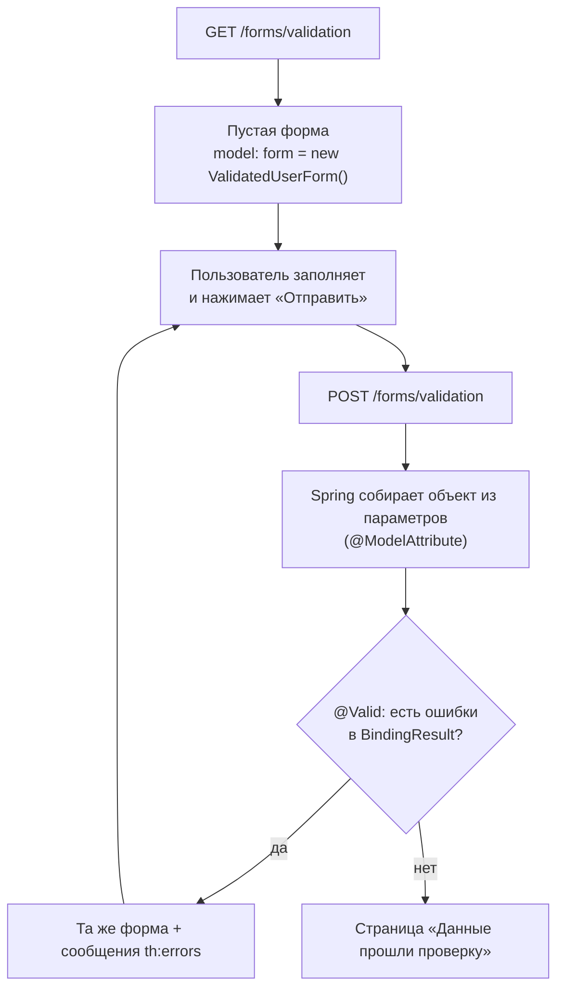

# Практика 5 — Формы

**Основа:** А. Постолит «Python, Django и PyCharm», глава 6 (разделы 6.1–6.4.6).
**Реализация:** Java 17, Spring Boot (Spring MVC + Thymeleaf + Bean Validation). Сдаётся на Java вместо
Django, это согласовано с преподавателем.

Код лежит в пакете [`ru.college.practice.forms`](../src/main/java/ru/college/practice/forms):
- [`UserFormController`](../src/main/java/ru/college/practice/forms/UserFormController.java) — разделы 6.1–6.2 и 6.4;
- [`FieldsController`](../src/main/java/ru/college/practice/forms/FieldsController.java) — раздел 6.3.

Шаблоны: [`templates/forms`](../src/main/resources/templates/forms). Тесты:
[`FormsTest.java`](../src/test/java/ru/college/practice/forms/FormsTest.java).

## Соответствие Django → Spring

| Django (книга) | Spring Boot |
|---|---|
| класс формы `class UserForm(forms.Form)` | обычный класс с полями, геттерами и сеттерами |
| `{{ form }}` — HTML формы генерируется сам | разметка пишется в шаблоне: `th:object="${form}"` + `th:field="*{name}"` |
| метка поля `label="Имя клиента"` | `<label th:for="name">Имя клиента:</label>` |
| `if request.method == "POST":` в одной функции | два метода на один адрес: `@GetMapping` и `@PostMapping` |
| `request.POST.get("name")` | `@ModelAttribute("form") UserForm form` — объект собирается из параметров запроса |
| `` | в проекте нет Spring Security, поэтому токена нет. Если его подключить, Thymeleaf сам добавит скрытое поле `_csrf` в любую форму с `th:action` |
| тип поля (`IntegerField`, `DateField`, …) | тип Java-поля (`Integer`, `LocalDate`, …): Spring сам преобразует строку |
| виджет (`TextInput`, `Textarea`, `Select`) | HTML-элемент (`<input>`, `<textarea>`, `<select>`) |
| `initial=...` | форма создаётся в контроллере с заполненными значениями |
| `field_order` | порядок полей в разметке. В примере он передаётся списком из контроллера |
| `help_text` | подсказка `<small>` рядом с полем |
| `form.as_table` / `as_ul` / `as_p` | три варианта разметки, написанные вручную |
| `min_length`, `max_value` и т. п. + `form.is_valid()` | аннотации `@Size`, `@Max`… + `@Valid` + `BindingResult` |
| `ValidationError` | ошибка в `BindingResult`, вывод через `th:errors` |

Главное отличие от Django: форма Django объединяет три вещи — описание полей, HTML и проверку. В Spring
у каждой своё место: класс с данными, шаблон Thymeleaf и аннотации проверки.

## Страницы

| Адрес | Раздел книги |
|---|---|
| http://localhost:8080/forms | 6.1–6.2: форма «Имя / Возраст», ответ на POST |
| http://localhost:8080/forms/fields | 6.3: все типы полей |
| http://localhost:8080/forms/settings | 6.4.1–6.4.4: виджет, начальные значения, порядок полей, подсказки |
| http://localhost:8080/forms/layout | 6.4.5: форма как таблица, список и абзацы |
| http://localhost:8080/forms/validation | 6.4.6: проверка данных на сервере |

Адреса начинаются с `/forms`, потому что `/` уже занят главной страницей из практики 4.

---

## 6.1. Определение форм (листинги 6.1–6.4)

Класс формы — аналог `UserForm(forms.Form)` с полями `name` и `age`:

```java
public class UserForm {
    private String name;
    private Integer age;   // Integer, а не int: пустое поле станет null, а не ошибкой
    // геттеры и сеттеры
}
```

Контроллер передаёт пустую форму в шаблон (аналог `render(request, "firstapp/index.html", {"form": userform})`):

```java
@GetMapping("/forms")
public String getForm(Model model) {
    model.addAttribute("form", new UserForm());
    return "forms/new";
}
```

Шаблон `forms/new.html`:

```html
<form th:action="@{/forms}" th:object="${form}" method="post">
    <table>
        <tr>
            <th><label th:for="name">Имя клиента:</label></th>
            <td><input type="text" th:field="*{name}"></td>
        </tr>
        <tr>
            <th><label th:for="age">Возраст клиента:</label></th>
            <td><input type="number" th:field="*{age}"></td>
        </tr>
    </table>
    <input type="submit" value="Отправить">
</form>
```

`th:field="*{name}"` сам проставляет `id="name" name="name" value="..."`. `*{...}` — поле объекта,
указанного в `th:object`.

В Django метка по умолчанию берётся из имени поля (`Name`), а свою метку задаёт параметр `label`
(рис. 6.2, 6.7). В Thymeleaf метку всегда пишут вручную. Кириллица в именах полей (рис. 6.3–6.4) в Java
формально допустима, но так не делают. Поэтому поля названы латиницей, а метки — по-русски.

## 6.2. Использование в формах POST-запросов (листинги 6.5–6.6)

```java
@PostMapping("/forms")
public String postForm(@ModelAttribute("form") UserForm form) {
    return "forms/success";
}
```

`@ModelAttribute("form")` делает две вещи:
1. собирает объект `UserForm` из параметров `name` и `age` (аналог `request.POST.get("name")`);
2. кладёт его в модель под именем `form`.

Поэтому шаблон ответа берёт значения как `${form.name}`:

```html
<h2>Пользователь</h2>
<h3 th:text="|Имя - ${form.name}, Возраст - ${form.age}|">...</h3>
```

`|...|` — подстановка значений в строку. Без неё `th:text="Имя: ${name}"` даёт ошибку разбора шаблона.

| Действие | Результат |
|---|---|
| GET /forms | пустая форма с полями «Имя клиента» и «Возраст клиента» |
| ввести «Михаил», 45 → Отправить | **Пользователь** / Имя - Михаил, Возраст - 45 (как на рис. 6.9) |

## 6.3. Использование полей в формах

Все поля собраны в одном классе [`FieldsForm`](../src/main/java/ru/college/practice/forms/FieldsForm.java).
На странице `/forms/fields` каждое поле стоит в своей маленькой форме, как в примерах книги. Страница
ответа показывает, что пришло на сервер и **во что Spring превратил значение** (колонка «Тип в Java»).

| Раздел | Django | HTML | Тип в Java |
|---|---|---|---|
| 6.3.3 | `BooleanField` / `required=False` | `checkbox` с `required` / без | `Boolean` |
| 6.3.4 | `NullBooleanField` | `<select>`: Неизвестно / Да / Нет | `Boolean` (`null` = неизвестно) |
| 6.3.5 | `CharField(max_length=15)` | `text` + `maxlength="15"` | `String` |
| 6.3.6 | `EmailField` | `type="email"` | `String` |
| 6.3.7 | `GenericIPAddressField` | `text` + `pattern` для IPv4 | `String` |
| 6.3.8 | `RegexField("^[0-9][A-F][0-9]$")` | `pattern="[0-9][A-F][0-9]"` | `String` |
| 6.3.9 | `SlugField` | `pattern="[-a-zA-Z0-9_]+"` | `String` |
| 6.3.10 | `URLField` | `type="url"` | `String` |
| 6.3.11 | `UUIDField` | `text` | `java.util.UUID` |
| 6.3.12 | `ComboField([CharField(max_length=20), URLField()])` | `type="url"` + `maxlength="20"` | `String` |
| 6.3.13 | `FilePathField(path=..., allow_folders=True)` | `<select>` со списком файлов каталога | `String` |
| 6.3.14 | `FileField` | `type="file"`, форма `multipart/form-data` | `MultipartFile` |
| 6.3.15 | `ImageField` | `type="file" accept="image/*"` | `MultipartFile` |
| 6.3.16 | `DateField` | `type="date"` | `LocalDate` |
| 6.3.17 | `TimeField` | `type="time"` | `LocalTime` |
| 6.3.18 | `DateTimeField` | `type="datetime-local"` | `LocalDateTime` |
| 6.3.19 | `DurationField` | `text` + `pattern` под `DD HH:MM:SS` | `String` → `java.time.Duration` |
| 6.3.20 | `SplitDateTimeField` | два поля: `date` + `time` | `LocalDate` + `LocalTime` |
| 6.3.21 | `IntegerField` | `type="number"` | `Integer` |
| 6.3.22 | `DecimalField(decimal_places=2)` | `number` + `step="0.01"` | `BigDecimal` |
| 6.3.23 | `FloatField` | `number` + `step="any"` | `Double` |
| 6.3.24 | `ChoiceField` | `<select>` | `String` |
| 6.3.25 | `TypedChoiceField(coerce=int)` | `<select>` | `Integer` |
| 6.3.26 | `MultipleChoiceField` | `<select multiple>` | `List<String>` |
| 6.3.27 | `TypedMultipleChoiceField` (города, листинг 6.37) | `<select multiple>` | `List<Integer>` |

Пример из класса формы:

```java
@DateTimeFormat(iso = ISO.DATE)
private LocalDate date;          // "2025-10-10" → LocalDate

private UUID uuidText;           // строка → UUID, неверный формат даст ошибку
private List<Integer> cities;    // <select multiple> → список чисел (coerce=int)
private MultipartFile file;      // аналог UploadedFile
```

Две проверки, которые стоит различать:
- **В браузере** работают атрибуты `required`, `type="email"`, `pattern`, `maxlength`, `step`. Это
  предупреждения на рис. 6.11, 6.15, 6.18, 6.23, 6.41 и 6.43. Их легко обойти, например отправив запрос
  не из браузера.
- **На сервере** Spring приводит строку к типу поля. Если не получилось (например, `abc` в поле UUID),
  в `BindingResult` появляется ошибка, и страница ответа выводит «неверный формат значения». Это аналог
  метода `clean()` и `ValidationError` в Django.

`FilePathField`: в книге список строится по папке `C:/Python37/`. Здесь берётся папка, из которой запущено
приложение (`System.getProperty("user.dir")`), а вложенные папки отмечены `/`, как при `allow_folders=True`.

## 6.4. Настройка формы и её полей

Страница `/forms/settings`:

```java
@GetMapping("/forms/settings")
public String settings(@RequestParam(defaultValue = "age,name,comment") List<String> order, Model model) {
    model.addAttribute("form", new UserForm("Введите ФИО", 18));   // initial (листинг 6.40)
    model.addAttribute("order", order);                            // field_order (листинги 6.41–6.42)
    return "forms/settings";
}
```

- **6.4.1. `widget=forms.Textarea`.** Поле комментария сделано элементом `<textarea>`.
- **6.4.2. `initial`.** Форма создаётся уже заполненной: «Введите ФИО» и 18 (рис. 6.55).
- **6.4.3. `field_order`.** Шаблон перебирает список `order` и через `th:switch` рисует нужное поле.
  По умолчанию сначала идёт возраст, потом имя (рис. 6.56). Порядок можно поменять в адресе:
  `/forms/settings?order=name,age,comment`.
- **6.4.4. `help_text`.** Подсказки «Введите ФИО» и «Введите возраст» под полями (рис. 6.57).

```html
<tr th:each="field : ${order}" th:switch="${field}">
    <th:block th:case="'name'"> ... поле имени ... </th:block>
    <th:block th:case="'age'"> ... поле возраста ... </th:block>
    <th:block th:case="'comment'"> ... textarea ... </th:block>
</tr>
```

### 6.4.5. Настройки вида формы (листинг 6.46)

У Django есть методы `as_table()`, `as_ul()` и `as_p()`. В Thymeleaf готовых генераторов нет, поэтому на
странице `/forms/layout` одна и та же форма размечена трижды: строками `<table>`, пунктами `<ul>` и
абзацами `<p>`. Результат совпадает с рис. 6.58.

### 6.4.6. Проверка (валидация) данных

*(Скриншоты главы заканчиваются на первом абзаце этого раздела. Пример составлен по его описанию.)*

Правила проверки задаются аннотациями в классе
[`ValidatedUserForm`](../src/main/java/ru/college/practice/forms/ValidatedUserForm.java):

```java
@NotBlank(message = "Введите имя")
@Size(min = 2, max = 20, message = "Имя должно содержать от 2 до 20 символов")
private String name;

@NotNull(message = "Введите возраст")
@Min(value = 1, message = "Возраст не может быть меньше 1")
@Max(value = 120, message = "Возраст не может быть больше 120")
private Integer age;

@NotBlank(message = "Введите электронный адрес")
@Email(message = "Некорректный электронный адрес")
private String email;
```

Контроллер — аналог `if userform.is_valid():`:

```java
@PostMapping("/forms/validation")
public String validationSubmit(@Valid @ModelAttribute("form") ValidatedUserForm form, BindingResult result) {
    if (result.hasErrors()) {
        return "forms/validation";   // та же форма: введённые данные и сообщения об ошибках
    }
    return "forms/valid";
}
```

`BindingResult` должен стоять **сразу после** проверяемого параметра. Иначе при ошибке Spring сам вернёт
ответ 400.

В шаблоне:

```html
<input type="number" th:field="*{age}" th:errorclass="field-error">
<span class="error" th:if="${#fields.hasErrors('age')}" th:errors="*{age}">ошибка</span>
```

- `th:errors` выводит текст ошибки поля.
- `th:errorclass` добавляет полю красную рамку, только если в нём ошибка.
- Атрибут `novalidate` у формы отключает проверку в браузере, чтобы данные дошли до сервера.
- Если в поле возраста ввести не число, сработает ошибка преобразования. Её текст «Неверный формат
  значения» задан в `messages.properties`.

| Ввод | Результат |
|---|---|
| все поля пустые | у каждого поля красная рамка и сообщение «Введите …» |
| «Я», 200, `info@` | «Имя должно содержать от 2 до 20 символов», «Возраст не может быть больше 120», «Некорректный электронный адрес» |
| «Михаил», 45, `info@example.com` | «Данные прошли проверку» |

---

## Схема обработки формы



## Проверка

Автотесты: 15 проверок в `FormsTest`, всего в проекте 39.
- GET и POST формы, русские имена в POST-запросе;
- вид всех типов полей и преобразование значений в `Boolean`, `UUID`, `LocalDate`, `LocalDateTime`,
  `BigDecimal`, `Integer`, `List<Integer>`;
- ошибка формата UUID, разбор `DurationField`, загрузка файла;
- начальные значения, порядок полей, три вида формы;
- валидация: пустые поля, значения вне диапазона, не число в возрасте, правильные данные.

```bash
./mvnw test -Dtest=FormsTest
```

Ручная проверка: запустить `SpringBootPracticeApplication` и открыть http://localhost:8080/forms. Внизу
страницы есть ссылки на остальные примеры.

### Что отсутствует в скриншотах книги

Страниц 177, 194, 198, 201–203 и 207–209 нет, раздел 6.4.6 обрывается на первом абзаце. Поэтому:
- обработка POST в 6.2 сделана по описанию к рис. 6.9;
- примеры `ComboField`, `DateTimeField`, `DurationField`, `SplitDateTimeField`, `ChoiceField`,
  `TypedChoiceField` и `MultipleChoiceField` сделаны по табл. 6.1;
- форма в 6.4.6 составлена по описанию раздела.
