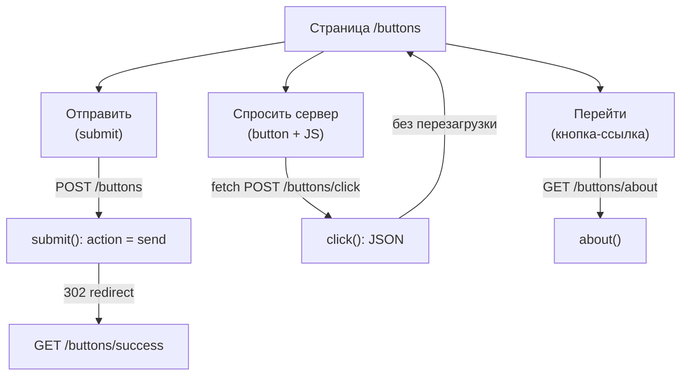

# Практика 6 — Формы с кнопками

**Основа:** методичка «Формы с кнопками» (дополнение к главе 6, «Формы»).
**Реализация:** Java 17, Spring Boot (Spring MVC + Thymeleaf). Сдаётся на Java вместо Django, это
согласовано с преподавателем.

Код:
- контроллер [`ButtonsController.java`](../src/main/java/ru/college/practice/buttons/ButtonsController.java);
- шаблоны [`templates/buttons`](../src/main/resources/templates/buttons);
- тесты [`ButtonsTest.java`](../src/test/java/ru/college/practice/buttons/ButtonsTest.java).

Страница: http://localhost:8080/buttons

## Соответствие Django → Spring

| Django (методичка) | Spring Boot |
|---|---|
| `<button type="submit">` в шаблоне | то же самое в шаблоне Thymeleaf |
| `` | `th:action="@{...}"`: если подключить Spring Security, токен добавится сам |
| `def my_view(request)` с `if request.method == 'POST'` | два метода: `@GetMapping("/buttons")` и `@PostMapping("/buttons")` |
| `return redirect('success_page')` | `return "redirect:/buttons/success"` |
| `return render(request, 'your_template.html')` | `return "buttons/index"` |
| JS-функция отправляет запрос на отдельный URL, обрабатываемый во `views.py` | `fetch("/buttons/click")` → метод с `@ResponseBody`, ответ в JSON |

## 1. Кнопка для отправки формы

```html
<form method="post" th:action="@{/buttons}">
    <label for="name">Ваше имя:</label>
    <input type="text" id="name" name="name">
    <button type="submit" name="action" value="send">Отправить</button>
    <button type="submit" name="action" value="clear">Очистить</button>
</form>
```

```java
@PostMapping("/buttons")
public String submit(@RequestParam(defaultValue = "") String name,
                     @RequestParam String action,
                     RedirectAttributes redirect) {
    if ("clear".equals(action)) {
        return "redirect:/buttons";
    }
    redirect.addFlashAttribute("name", name.isBlank() ? "аноним" : name);
    return "redirect:/buttons/success";
}
```

- **Две submit-кнопки в одной форме.** У обеих `name="action"`, но разные `value`. Браузер отправляет
  значение только нажатой кнопки, поэтому сервер понимает, какую нажали.
- **Redirect после POST** (схема Post/Redirect/Get), как `redirect('success_page')` в методичке. Если
  обновить страницу результата, форма не отправится повторно.
- **Flash-атрибут** переносит имя через redirect. Он живёт до следующего запроса: если обновить
  `/buttons/success`, данных уже нет, и страница сообщает об этом.
- Flash-атрибуты хранятся в сессии. Чтобы номер сессии не попадал в адрес (`;jsessionid=...`), в
  `application.properties` задано `server.servlet.session.tracking-modes=cookie`.

| Действие | Результат |
|---|---|
| ввести «Анна» → **Отправить** | 302 → `/buttons/success`: «Форма отправлена. Здравствуйте, Анна!» |
| **Отправить** с пустым полем | «Здравствуйте, аноним!» |
| **Очистить** | 302 → снова пустая форма `/buttons` |
| обновить страницу результата | «Нет данных формы…» |

## 2. Кнопка без отправки формы (JavaScript)

```html
<button type="button" onclick="myJavaScriptFunction()">Нажми меня</button>
<button type="button" onclick="askServer()">Спросить сервер</button>
```

`type="button"` означает, что кнопка ничего не отправляет. Что она делает, решает JavaScript.

- **«Нажми меня»** выполняется целиком в браузере и выводит время нажатия. Сервер в этом не участвует.
- **«Спросить сервер»** — пример из методички: «JS-функция отправляет запрос на отдельный URL». Страница
  при этом не перезагружается:

```javascript
async function askServer() {
    const response = await fetch("/buttons/click", {method: "POST"});
    const data = await response.json();
    document.getElementById("server-answer").textContent =
        "Сервер: нажатий " + data.clicks + ", время " + data.time;
}
```

```java
@PostMapping("/buttons/click")
@ResponseBody                       // ответ — данные, а не имя шаблона
public Map<String, Object> click() {
    return Map.of("clicks", clicks.incrementAndGet(), "time", ...);   // Spring превратит Map в JSON
}
```

## 3. Кнопка-ссылка

```html
<a th:href="@{/buttons/about}">
    <button type="button">Перейти</button>
</a>
```

Нажатие на кнопку — это переход по ссылке, то есть обычный GET-запрос. Его обрабатывает
`@GetMapping("/buttons/about")`, а страница показывает, сколько раз нажимали «Спросить сервер».

Это вариант из методички. По стандарту HTML кнопку нельзя класть внутрь ссылки, хотя браузеры такую
разметку понимают. Более правильные способы: ссылка, оформленная через CSS под кнопку, или
`<form method="get" action="/buttons/about"><button>Перейти</button></form>`.

## Схема



## Проверка

Автотесты: 7 проверок в `ButtonsTest`, всего в проекте 46.
- на странице есть все три вида кнопок;
- submit делает redirect и передаёт имя flash-атрибутом, пустое имя становится «аноним»;
- «Очистить» возвращает к форме, страница успеха без данных выводит подсказку;
- JS-адрес возвращает JSON, кнопка-ссылка открывает другую страницу.

```bash
./mvnw test -Dtest=ButtonsTest
```

JavaScript-кнопки автотесты не запускают, их я проверил вручную в браузере: «Нажми меня» выводит время,
«Спросить сервер» показывает растущий счётчик.
